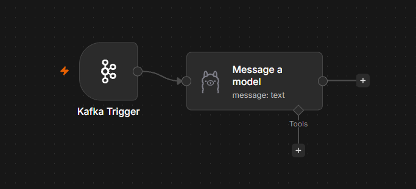
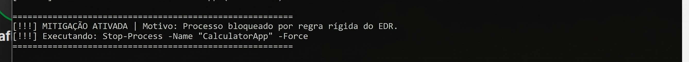

# Motor de Segurança de Endpoints (EDR) com Análise Comportamental e Mitigação por IA

Um sistema EDR (*Endpoint Detection and Response*) de nível *Enterprise*, construído do zero para monitorar, analisar e mitigar ameaças em ambientes Windows em tempo real. A arquitetura combina captura de eventos em nível de Kernel, transporte gRPC de alta performance, mensageria assíncrona com Apache Kafka e orquestração de resposta a incidentes utilizando Inteligência Artificial local.

> 💡 **Sobre o ambiente de desenvolvimento:** o computador usado no desenvolvimento (Windows) possui uma limitação de virtualização, o que impede de rodar o Docker localmente. Para contornar isso, a infraestrutura de contêineres (Redpanda, n8n e Ollama) roda em um **servidor Ubuntu Server montado a partir de um notebook antigo**, enquanto o Gateway e o Agente rodam no Windows e se comunicam com ele pela rede.

## 🚀 Arquitetura do Sistema

O projeto adota uma arquitetura de microsserviços distribuída, desenhada para garantir resiliência, baixa latência e processamento em lote (*batch processing*).

1. **Agente (Sensor & Executor):** monitora a criação de processos diretamente no Kernel do Windows via ETW (*Event Tracing for Windows*), sem bloquear o sistema operacional. Os eventos são colocados em uma fila de memória de alta performance (`Channel`) e enviados em lotes.
2. **Gateway (Ingestão & Controle):** serviço gRPC bidirecional que recebe a telemetria, injeta-a em um cluster Kafka e mantém um canal seguro e persistente aberto com o Agente para enviar comandos de mitigação (*callbacks*).
3. **Infraestrutura de Mensageria:** Redpanda (compatível com Apache Kafka) rodando em contêineres Docker para absorver picos de tráfego de telemetria de múltiplos endpoints.
4. **Cérebro (Automação & IA):** o n8n atua como motor de orquestração SOAR (*Security Orchestration, Automation, and Response*), consumindo ativamente o tópico Kafka e alimentando o modelo LLM (Ollama) para gerar scripts PowerShell cirúrgicos de resposta a ameaças.

### Fluxo de Orquestração SOAR (n8n + Ollama)



*Fluxo atual no n8n: o **Kafka Trigger** consome continuamente a telemetria do tópico e encaminha cada evento para o nó **Message a model** (Ollama), que faz a análise comportamental e gera a resposta de mitigação. O retorno ao Gateway via webhook ainda está no roadmap.*

## 🛠️ Stack Tecnológico

| Área | Tecnologia |
|---|---|
| **Linguagem principal** | C# (.NET 8/9) |
| **Comunicação** | gRPC (streams bidirecionais), Protocol Buffers (Protobuf) |
| **Monitoramento nativo** | ETW (`Microsoft.Diagnostics.Tracing.TraceEvent`) |
| **Mensageria/Fila** | Apache Kafka / Redpanda (`Confluent.Kafka`) |
| **Orquestração SOAR** | n8n |
| **Inteligência Artificial** | Ollama (LLM `phi3` para geração de código local e segura) |
| **Infraestrutura** | Docker, Ubuntu Linux |

## ✨ Funcionalidades Principais

* **Captura em nível de Kernel:** utilização de `KernelTraceEventParser` para interceptar o ciclo de vida de processos no exato milissegundo em que ocorrem.
* **Telemetria de alta velocidade:** sistema produtor/consumidor com `Channel<T>` para evitar bloqueios de I/O na máquina hospedeira.
* **Comunicação bidirecional contínua:** contratos gRPC avançados (`AsyncDuplexStreamingCall`) que permitem streaming de telemetria e recebimento instantâneo de comandos de defesa no mesmo túnel.
* **Execução silenciosa de mitigações:** o Agente invoca respostas geradas pela IA diretamente no `powershell.exe`, operando de forma 100% invisível ao usuário (`CreateNoWindow = true`).
* **Segurança e estabilidade:** mecanismos de proteção, *whitelisting* e isolamento de processos vitais do sistema (ex.: prevenção de `NullReferenceException` no `svchost`).

## ⚙️ Como Executar o Projeto

### Pré-requisitos

* .NET SDK 8.0 ou superior
* Ambiente Linux (ou WSL) com Docker para rodar a infraestrutura Kafka/n8n/Ollama
* Privilégios de Administrador no Windows (obrigatório para interagir com o ETW)
* [Npcap](https://npcap.com) instalado no Windows (necessário para o sniffer de rede via SharpPcap; sem ele o Agente exibe `DllNotFoundException: wpcap`)

### 1. Subir a infraestrutura (Ubuntu/Docker)

Inicia o cluster Redpanda, o banco de dados vetorial, o n8n e o Ollama:

```bash
docker compose up -d
```

### 2. Iniciar o Gateway (Windows)

O Gateway fica escutando na porta gRPC:

```powershell
cd EdrGateway
dotnet run
```

### 3. Iniciar o Agente (Windows)

Em uma nova janela de terminal, **como Administrador**:

```powershell
cd EdrAgentMonitor
dotnet run
```

### Saída do Agente (EdrAgentMonitor)



*O Agente rodando no Windows: o evento de Kernel (ETW) detecta a criação do processo `CalculatorApp` (PID 25116) e a mitigação é executada imediatamente com `Stop-Process -Name "CalculatorApp" -Force`, depois que o processo é bloqueado por uma regra rígida do EDR. O erro `wpcap` no início da captura corresponde ao sniffer de rede, que exige o Npcap instalado (veja os pré-requisitos).*

## 🗺️ Próximos Passos (Roadmap)

- [ ] **Assinaturas criptográficas:** implementar verificação ECDSA P-256 no Agente para garantir que os comandos de mitigação não possam ser forjados por atacantes na rede (Zero Trust).
- [ ] **Integração plena do webhook:** ligar o fluxo automatizado do n8n (pós-análise da IA) diretamente à API do Gateway, completando o ciclo de resposta 100% autônomo.
- [ ] **Análise heurística secundária:** detecção de injeção de DLLs e padrões anômalos de tráfego de rede via SharpPcap.

---

*Desenvolvido como demonstração de engenharia de software avançada, sistemas distribuídos e cibersegurança.*